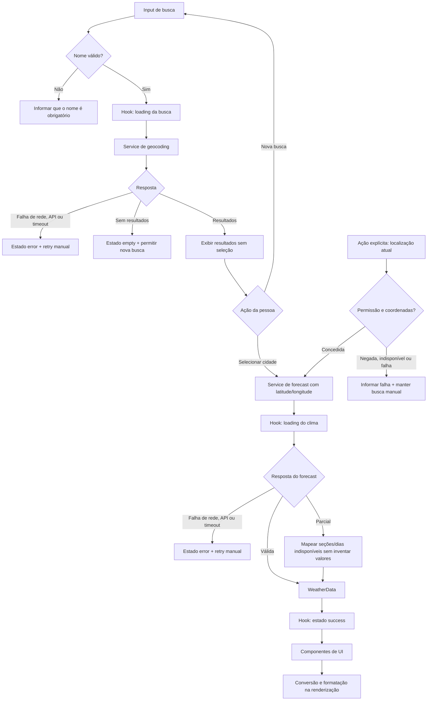

# Plano Técnico — Weather App

Este plano deriva da [especificação do produto](../specs/weather-app-spec.md), fonte de verdade funcional da v1. Define decisões, contratos e estratégia de validação; não é a implementação final.

## Architecture

A aplicação será um web app client-side sem backend próprio. A arquitetura separa interface, orquestração do fluxo, integração HTTP e funções puras:

```text
components (React)
       │ eventos e props
       ▼
hooks (estado e orquestração)
       │ chamadas tipadas
       ├──────────────► services (Open-Meteo, fetch e mapeamento)
       │                         │
       │                         ▼
       │                  APIs externas
       ▼
lib (conversões, formatação e códigos WMO)
       │
       ▼
types (contratos compartilhados)
```

- **Apresentação:** componentes exibem busca, resultados, clima atual, previsão e mensagens de estado em pt-BR; não fazem requisições e usam controles com nomes acessíveis e suporte a teclado.
- **Orquestração:** um hook de tela coordena busca, seleção, geolocalização, consulta, retry e unidade.
- **Acesso a dados:** services encapsulam endpoints, timeout, validação básica e conversão das respostas externas para os tipos da aplicação.
- **Funções puras:** `lib` contém conversão de temperatura, mapeamento de códigos meteorológicos e formatação localizada, sem efeitos colaterais.
- **Contratos:** `types` define modelos de domínio, estados e erros compartilhados.

A separação mantém a interface testável com estados controlados, permite testar services sem React e valida funções puras sem rede.

## Tech Stack

| Área | Decisão | Motivo |
| --- | --- | --- |
| Linguagem | TypeScript com `strict` | Detectar inconsistências nos contratos e no tratamento de respostas parciais. |
| UI e build | React + Vite | Stack do projeto, adequada para uma aplicação client-side pequena. |
| Estilo | Tailwind CSS, tema dark glassmorphism | Segue as convenções visuais do projeto. |
| Testes unitários e de UI | Vitest + Testing Library | Testes rápidos de funções, services e comportamento acessível dos componentes. |
| Testes E2E | Playwright | Validar fluxos reais no browser e viewport mobile. |
| Qualidade | Biome | Lint e formatação conforme a stack do projeto. |
| Dados meteorológicos | Open-Meteo Geocoding e Forecast APIs | Atende busca e previsão sem chave de API, conforme a spec. |
| Gerenciador de pacotes | pnpm | Convenção do projeto. |

Não fixar versões ou adicionar bibliotecas de estado, datas, rede ou validação sem necessidade demonstrada; preferir APIs nativas (`fetch`, `AbortController`, `Intl`) e as dependências já adotadas.

## Project Structure

Estrutura proposta para `src/`:

```text
src/
├── components/
│   ├── CitySearch.tsx
│   ├── CityResults.tsx
│   ├── CurrentWeatherCard.tsx
│   ├── ForecastList.tsx
│   ├── UnitToggle.tsx
│   └── StatusMessage.tsx
├── hooks/
│   └── useWeatherApp.ts
├── services/
│   ├── geocodingService.ts
│   └── forecastService.ts
├── lib/
│   ├── temperature.ts
│   ├── weatherCode.ts
│   └── formatting.ts
└── types/
    └── weather.ts
```

- `components/`: apresentação e interação acessível; cada componente em seu arquivo.
- `hooks/`: coordenação de estado e ações da tela; nenhum componente precisa conhecer detalhes HTTP.
- `services/`: construção das requisições, timeout, validação das respostas externas e mapeamento para o domínio.
- `lib/`: funções puras compartilhadas e testáveis, inclusive conversão de unidade e descrição dos códigos WMO.
- `types/`: contratos usados por UI, hook e services.

Os nomes são uma proposta inicial, não exigem criar todos os arquivos se a implementação puder manter a mesma separação com menos componentes.

## Data Model

Os services convertem o formato externo da Open-Meteo para um modelo interno independente da resposta HTTP. Temperaturas são mantidas em Celsius no modelo; unidade de exibição é derivada na renderização.

```ts
export type Unit = 'celsius' | 'fahrenheit';

export interface City {
  id: number; // Identificador do local retornado pelo geocoding.
  name: string; // Nome da cidade/local.
  admin1?: string; // Região ou estado, quando disponível.
  country: string; // País para distinguir resultados homônimos.
  countryCode?: string; // Código ISO do país, quando disponível.
  latitude: number; // Latitude usada na consulta de previsão.
  longitude: number; // Longitude usada na consulta de previsão.
  timezone?: string; // Fuso retornado pelo geocoding, quando disponível.
}

export interface CurrentWeather {
  time: string; // Horário local informado pela API.
  temperatureC: number; // Temperatura atual em graus Celsius.
  apparentTemperatureC: number; // Sensação térmica em graus Celsius.
  weatherCode: number; // Código WMO da condição atual.
  condition: string; // Descrição pt-BR derivada do código WMO.
  relativeHumidityPercent: number; // Umidade relativa em percentual.
  windSpeedKmh: number; // Velocidade do vento em km/h.
  precipitationMm?: number | null; // Precipitação atual em mm, quando disponível.
  pressureHpa?: number | null; // Pressão atmosférica em hPa, quando disponível.
}

export interface ForecastDay {
  date: string; // Data local no formato YYYY-MM-DD retornada pela API.
  available: boolean; // Indica se todos os campos obrigatórios do dia estão disponíveis.
  weatherCode: number | null; // Código WMO; null quando o dia está incompleto.
  condition: string | null; // Descrição pt-BR; neutra para código desconhecido.
  minTemperatureC: number | null; // Mínima em graus Celsius, sem valor fabricado.
  maxTemperatureC: number | null; // Máxima em graus Celsius, sem valor fabricado.
  precipitationProbabilityPercent: number | null; // Probabilidade máxima diária em percentual.
}

export interface WeatherData {
  city: City | null; // Cidade selecionada; null para uma consulta por coordenadas atuais.
  timezone: string; // Fuso do destino retornado pela API de previsão.
  current: CurrentWeather | null; // null quando algum campo obrigatório da seção está ausente.
  forecast: ForecastDay[]; // Dias retornados; dias incompletos permanecem identificados.
}
```

Uma resposta atual incompleta torna `current` indisponível sem invalidar dias completos. Cada dia da previsão exige data, código meteorológico, mínima, máxima e probabilidade de precipitação; se faltar qualquer campo, `available` será `false` e os valores ausentes continuarão `null`. Um código WMO desconhecido não torna os demais campos inválidos: `condition` recebe um rótulo neutro. Coordenadas de geolocalização existem somente no fluxo da consulta e não são gravadas no armazenamento local.

### Contratos auxiliares de estado e erro

O hook mantém estados discriminados por operação: busca (`idle | loading | success | empty | error`) e previsão (`idle | loading | success | error`). `success` da busca contém resultados ainda não selecionados; `empty` representa uma busca válida sem resultados. Erros de rede, timeout, resposta HTTP/API e resposta inválida devem ser distinguíveis internamente para a interface apresentar mensagem apropriada e retry.

## Data Flow

1. A pessoa envia um nome não vazio. O hook remove espaços nas extremidades, invalida a seleção anterior e limpa os dados que poderiam parecer atuais.
2. O hook chama o service de geocoding. O service consulta a API e converte os resultados para `City`.
3. Uma lista vazia gera estado `empty`; resultados são mostrados sem seleção automática.
4. A seleção explícita de um resultado inicia a consulta de previsão. A ação de localização atual segue o mesmo fluxo de forecast usando coordenadas obtidas após consentimento explícito, sem passar pelo geocoding.
5. O service de forecast mapeia seções completas e dias incompletos para `WeatherData`.
6. O hook atualiza estado de sucesso ou erro; os componentes renderizam o resultado e a unidade escolhida. Uma nova consulta não mantém dados antigos visíveis como se fossem atuais.



## External APIs

### Geocoding

- **URL:** `https://geocoding-api.open-meteo.com/v1/search`
- **Método:** `GET`
- **Parâmetros usados:**
  - `name`: texto de busca após trim; preservar caracteres acentuados, apóstrofos e hífens e deixar `URLSearchParams` fazer o escaping.
  - `count=10`: limitar o número inicial de opções sem selecionar resultado implicitamente.
  - `language=pt`: solicitar nomes localizados em português quando disponíveis.
  - `format=json`: resposta JSON.
- **Resposta resumida:**

```json
{
  "results": [
    {
      "id": 3448439,
      "name": "São Paulo",
      "latitude": -23.5475,
      "longitude": -46.6361,
      "country": "Brasil",
      "country_code": "BR",
      "admin1": "São Paulo",
      "timezone": "America/Sao_Paulo"
    }
  ]
}
```

`results` é convertido para `City`; `admin1`, `country_code` e `timezone` podem não existir e devem ser tratados como opcionais. Uma resposta sem resultados conduz ao estado `empty`. A seleção do resultado é sempre explícita antes da requisição meteorológica.

### Forecast

- **URL:** `https://api.open-meteo.com/v1/forecast`
- **Método:** `GET`
- **Parâmetros usados:**
  - `latitude` e `longitude`: coordenadas da `City` selecionada ou da geolocalização aprovada.
  - `current=temperature_2m,apparent_temperature,weather_code,relative_humidity_2m,wind_speed_10m`: campos necessários ao clima atual.
  - `daily=weather_code,temperature_2m_min,temperature_2m_max,precipitation_probability_max`: resumo diário, temperaturas e chance de precipitação.
  - `temperature_unit=celsius`: resposta canônica em Celsius para que a escolha de unidade não exija outra requisição.
  - `wind_speed_unit=kmh`: unidade exigida pela spec.
  - `timezone=auto`: calendário e horários locais ao destino.
  - `forecast_days=5`: hoje e os quatro dias seguintes no fuso local.
- **Resposta resumida:**

```json
{
  "timezone": "America/Sao_Paulo",
  "current": {
    "time": "2026-10-27T14:00",
    "temperature_2m": 22.4,
    "apparent_temperature": 23.1,
    "weather_code": 2,
    "relative_humidity_2m": 64,
    "wind_speed_10m": 12.5
  },
  "daily": {
    "time": ["2026-10-27", "2026-10-28"],
    "weather_code": [2, 61],
    "temperature_2m_min": [17.2, 18.0],
    "temperature_2m_max": [25.1, 24.3],
    "precipitation_probability_max": [10, 70]
  }
}
```

O exemplo omite três dos cinco dias para ser conciso. O service mapeia `current` para `CurrentWeather`, os arrays paralelos de `daily` por índice para `ForecastDay` e o campo de resposta `timezone` para `WeatherData.timezone`. Validar presença e tipo dos campos ao mapear; arrays ausentes, curtos ou com valores não numéricos tornam os dias afetados indisponíveis, nunca zero. Os códigos `weather_code` seguem códigos WMO e são traduzidos para descrições pt-BR por função pura.

## State Management

- Manter o estado da tela em `useWeatherApp`; não introduzir store global para uma única tela e um único fluxo de consulta.
- Modelar busca e clima com estados explícitos `idle`, `loading`, `success`, `error` e `empty` onde aplicável. `empty` é próprio da busca sem resultados; uma previsão sem dias completos continua sendo uma consulta bem-sucedida com dias marcados como indisponíveis.
- Guardar em memória os resultados de geocoding para seleção explícita e os dados da consulta corrente. Ao iniciar outra busca ou seleção, invalidar os dados anteriores visíveis e cancelar/ignorar uma requisição substituída.
- Solicitar geolocalização apenas após ação da pessoa. Usar coordenadas somente para a consulta iniciada; não persistir coordenadas, local ou histórico.
- Manter `Unit` no hook e restaurar/salvar apenas essa preferência em `localStorage`. O padrão é `celsius`; se o armazenamento falhar, manter o valor escolhido em memória durante a sessão.
- Armazenar no modelo somente temperaturas Celsius. Derivar Celsius/Fahrenheit na renderização (`°F = °C × 9/5 + 32`) e formatar com `Intl.NumberFormat('pt-BR')`. Mudança de unidade atualiza imediatamente clima atual e todos os dias, sem nova chamada de rede; vento e percentuais não são convertidos.
- Tratar `daily.time` como data-calendário local `YYYY-MM-DD` da API. Não interpretá-la como instante no fuso do dispositivo; formatá-la preservando a data retornada e usar `WeatherData.timezone` para qualquer formatação que envolva um instante.

## Error Handling

- **Validação da busca:** trim antes de validar; string vazia não chama geocoding e apresenta orientação para informar o nome da cidade.
- **Rede e HTTP/API:** tratar falhas de `fetch`, respostas HTTP não bem-sucedidas e erros explícitos do payload como erro recuperável; informar indisponibilidade, não mostrar dados antigos como atuais e disponibilizar retry manual.
- **Timeout:** cada requisição de dados tem limite de 10 segundos. `AbortController` cancela a requisição ao atingir o prazo; a interface identifica timeout e oferece retry acionado pela pessoa. Não há retry automático.
- **Requisições substituídas:** abortar a chamada anterior ou ignorar sua conclusão quando uma busca/seleção mais recente a substitui, evitando que resposta fora de ordem sobrescreva o estado atual.
- **Resposta vazia:** ausência de locais no geocoding é `empty`, não falha. Uma lista vazia de previsão não deve ser apresentada como cinco dias disponíveis.
- **Resposta parcial:** validar independentemente clima atual e previsão. A seção atual é `null` se faltar algum campo obrigatório; manter dias completos e marcar como indisponíveis os dias que não contêm todos os campos requeridos.
- **Payload inválido:** rejeitar estrutura incompatível como erro de resposta, em vez de preencher valores padrão que possam parecer dados meteorológicos reais.
- **Código WMO desconhecido:** apresentar “Condição indisponível” e manter os demais valores válidos.
- **Geolocalização:** distinguir permissão negada, indisponibilidade do browser e falha da operação apenas o suficiente para informar a pessoa; preservar a busca manual como alternativa.
- **Preferência de unidade:** falha de leitura/gravação de `localStorage` não bloqueia a tela. Usar a unidade em memória na sessão e Celsius como padrão numa nova sessão sem preferência disponível.

## Testing Strategy

### Vitest + Testing Library

- **Funções puras:** conversões Celsius/Fahrenheit, arredondamento/formatação numérica pt-BR, formatação de datas locais sem deslocamento de dia e mapeamento de códigos WMO conhecidos/desconhecidos.
- **Services com `fetch` mockado:** URL e parâmetros de geocoding/forecast; escaping do texto de busca; mapeamento de campos e metadados; resposta vazia; falha HTTP/API; rejeição de rede; timeout/abort; resposta parcial e arrays `daily` desalinhados; códigos desconhecidos.
- **Hook e componentes:** transições de estado idle/loading/success/error/empty; busca vazia sem chamada; seleção explícita antes do forecast; mensagens e retry; unidade inicial e alteração sem nova chamada; persistência/fallback de unidade; localização sem solicitação automática; erros de permissão; ausência de dados antigos durante nova busca.
- **Acessibilidade comportamental:** nomes acessíveis, navegação e operação por teclado para busca, seleção, alternância de unidade e retry.
- **Acessibilidade visual:** revisar contraste e foco visível como parte da meta WCAG 2.2 AA, além dos testes de comportamento.

### Playwright

- **Fluxos E2E:** buscar cidade, selecionar resultado e ver clima/previsão; busca sem resultados; alternar unidade e recarregar; retry após falha; localização apenas após ação explícita (com permissão simulada); erro de localização sem bloquear busca manual.
- **Resiliência:** interceptar API para cobrir respostas lentas, erro e payload parcial; verificar que não há retry automático nem dados anteriores apresentados como atuais.
- **Viewport responsivo:** executar fluxos essenciais em 320 px, tamanho mobile comum e desktop; verificar que não há rolagem horizontal e que os controles permanecem operáveis.
- **Compatibilidade:** validar as duas versões estáveis mais recentes de Chrome, Safari, Firefox e Edge. Automatizar com Chromium, WebKit e Firefox no Playwright e incluir smoke checks nos navegadores estáveis alvo.
- **Performance:** em conexão estável, verificar renderização inicial em até 2 s e medir busca/previsão incluindo o tempo do provedor externo, com meta p95 de até 3 s. Definir o perfil e a instrumentação de produção antes de declarar conformidade operacional, conforme a questão aberta da spec.

## Risks & Trade-offs

| Decisão / risco | Trade-off e alternativa considerada |
| --- | --- |
| Celsius como unidade canônica recebida e armazenada | Uma requisição e conversão previsível sem rede ao alternar unidade; alternativa descartada: solicitar novamente ao provedor em cada alternância. |
| Estado local em um hook React | Simples para uma tela e evita dependência/store; alternativa: biblioteca global de estado, sem necessidade demonstrada na v1. |
| Chamadas diretas do browser à Open-Meteo | Sem backend, chave ou infraestrutura adicional; depende da disponibilidade, limites e condições do provedor. Validar atribuição, termos e limites antes do lançamento, como exige a spec. |
| Geolocalização opcional e iniciada pela pessoa | Atende privacidade e evita prompt no carregamento; pode falhar por permissão, contexto inseguro ou suporte do browser, mantendo busca manual. |
| Sem cache, modo offline ou retry automático | Evita exibir dados desatualizados e mantém o fluxo previsível; perde disponibilidade em rede instável, compensada por erro explícito e retry manual. |
| Respostas parciais preservadas por seção/dia | Mantém informação válida sem inventar valores; UI precisa indicar indisponibilidade de forma clara. |
| Datas diárias tratadas como datas locais da API | Evita deslocamento de calendário pelo fuso do dispositivo; exige preservar `YYYY-MM-DD` em vez de convertê-la como instante local. |
| Sem biblioteca adicional de datas/estado | Menos dependências para escopo pequeno; `Intl` e estado React são suficientes, mas formatação/fusos precisam de testes específicos. |
| Limite de 10 s e metas p95 dependentes de serviço externo | Timeout é contrato funcional; p95 de até 3 s depende também do provedor e da conexão, portanto deve ser medido em ambiente de produção. |

O escopo e as decisões atendem FR-01 a FR-07, AC-01.1–AC-07.2 e NFR-01–NFR-08 da spec. Permanecem como gates de publicação — não como bloqueios de desenvolvimento — as condições de uso/atribuição/limites da Open-Meteo, a hospedagem/SLO e o perfil de medição p95 descritos nas questões abertas da especificação.
